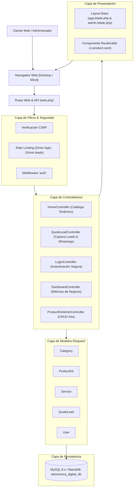

# MEMORIA TÉCNICA Y ARQUITECTURA DE SOFTWARE
## Sistema Web de Gestión y Difusión para Electrónica Digital MX

**Estudiante Residente:** Michael Hernández de Jesús  
**Carrera:** Ingeniería Informática - 9° Semestre  
**No. de Control:** 2022330136  
**Institución:** Tecnológico de Estudios Superiores de San Felipe del Progreso (ITESFPM)  
**Asesor Interno:** Luis Ángel González Flores  
**Asesor Externo:** Ing. Josué Verónica Pacheco (Gerente de Electrónica Digital MX)  

---

## 1. Arquitectura del Sistema
El sistema adopta el patrón arquitectónico **Modelo-Vista-Controlador (MVC)** sobre el framework **Laravel**, complementado con componentes reutilizables de **Blade** y una capa de persistencia relacional en **MySQL**.

---

## 2. Diccionario de Datos del Modelo Relacional

### 2.1 Tabla `users`
| Campo | Tipo | Nulo | Descripción |
| :--- | :--- | :--- | :--- |
| `id` | BIGINT UNSIGNED | No | Clave primaria autoincremental |
| `name` | VARCHAR(120) | No | Nombre del usuario/administrador |
| `email` | VARCHAR(150) | No | Correo electrónico único |
| `password` | VARCHAR(255) | No | Hash Bcrypt (costo 12) |
| `remember_token` | VARCHAR(100) | Sí | Token para persistencia de sesión |
| `created_at` / `updated_at` | TIMESTAMP | Sí | Marcas de tiempo de auditoría |

### 2.2 Tabla `categories`
| Campo | Tipo | Nulo | Descripción |
| :--- | :--- | :--- | :--- |
| `id` | BIGINT UNSIGNED | No | Clave primaria |
| `name` | VARCHAR(100) | No | Nombre de la categoría (CCTV, Acceso, etc.) |
| `slug` | VARCHAR(120) | No | Identificador amigable único |
| `icon` | VARCHAR(60) | No | Clase FontAwesome del icono |
| `is_active` | BOOLEAN | No | Estado de visibilidad |

### 2.3 Tabla `product_kits`
| Campo | Tipo | Nulo | Descripción |
| :--- | :--- | :--- | :--- |
| `id` | BIGINT UNSIGNED | No | Clave primaria |
| `category_id` | BIGINT UNSIGNED | No | Llave foránea a `categories.id` (ON DELETE CASCADE) |
| `name` | VARCHAR(150) | No | Nombre comercial del kit |
| `slug` | VARCHAR(180) | No | Slug único para indexación |
| `badge` | VARCHAR(50) | Sí | Distintivo visual (Más Vendido, etc.) |
| `estimated_price` | DECIMAL(10,2) | Sí | Precio estimado en MXN |
| `specs_summary` | TEXT | No | Resumen técnico (DVR, Cámaras, etc.) |
| `description` | TEXT | Sí | Descripción comercial detallada |
| `image_url` | VARCHAR(255) | Sí | Enlace a la fotografía |
| `features` | JSON | Sí | Arreglo de ventajas en viñetas |
| `includes_installation` | BOOLEAN | No | Indica si incluye mano de obra |
| `is_active` | BOOLEAN | No | Control de publicación |

### 2.4 Tabla `quote_leads`
| Campo | Tipo | Nulo | Descripción |
| :--- | :--- | :--- | :--- |
| `id` | BIGINT UNSIGNED | No | Clave primaria |
| `product_kit_id` | BIGINT UNSIGNED | Sí | Llave foránea a `product_kits.id` |
| `customer_name` | VARCHAR(120) | Sí | Nombre o referencia del solicitante |
| `customer_phone` | VARCHAR(30) | Sí | Teléfono / canal de contacto |
| `property_type` | VARCHAR(80) | Sí | Residencial, Comercial, Industrial |
| `camera_count` | VARCHAR(50) | Sí | Número de cámaras configuradas |
| `requires_installation` | VARCHAR(100) | Sí | Modalidad de servicio requerida |
| `message_payload` | TEXT | Sí | Texto formateado enviado a WhatsApp |
| `status` | ENUM | No | `nuevo`, `contactado`, `en_proceso`, `cerrado` |

---

## 3. Matriz de Endpoints y Rutas

| Método | Ruta | Nombre | Middleware | Función |
| :--- | :--- | :--- | :--- | :--- |
| `GET` | `/` | `home` | `web` | Renderiza catálogo y cotizador público |
| `POST` | `/api/quote-leads` | `quote-leads.store` | `throttle:15,1` | Registra cotización y genera enlace WhatsApp |
| `GET` | `/login` | `login` | `guest` | Formulario de acceso administrativo |
| `POST` | `/login` | `login.post` | `throttle:5,1` | Autentica credenciales y regenera sesión |
| `POST` | `/logout` | `logout` | `auth` | Destruye sesión y rota token |
| `GET` | `/admin` | `admin.dashboard` | `auth` | Tablero de control y métricas |
| `GET` | `/admin/kits` | `admin.kits.index` | `auth` | Listado y administración de kits |
| `GET` | `/admin/kits/create` | `admin.kits.create` | `auth` | Vista para dar de alta nuevo kit |
| `POST` | `/admin/kits` | `admin.kits.store` | `auth` | Procesa y valida almacenamiento de kit |
| `GET` | `/admin/kits/{kit}/edit` | `admin.kits.edit` | `auth` | Vista para editar kit existente |
| `PUT` | `/admin/kits/{kit}` | `admin.kits.update` | `auth` | Actualiza atributos del kit |
| `DELETE` | `/admin/kits/{kit}` | `admin.kits.destroy` | `auth` | Baja lógica/física del kit |

---

## 4. Requisitos y Despliegue en Servidor

### Requisitos Mínimos (Producción):
- **Sistema Operativo:** Linux Ubuntu Server 22.04 LTS o Contenedor Docker Alpine.
- **Servidor Web:** Nginx o servidor integrado detrás de Proxy Inverso con SSL/TLS.
- **PHP:** 8.2+ con extensiones: `pdo_mysql`, `mbstring`, `openssl`, `bcmath`, `curl`.
- **Base de Datos:** MySQL 8.0+ o MariaDB 10.4+.
- **Herramienta de despliegue automatizado:** Dockerfile multi-stage con optimización de caché (`config:cache`, `route:cache`, `view:cache`).
